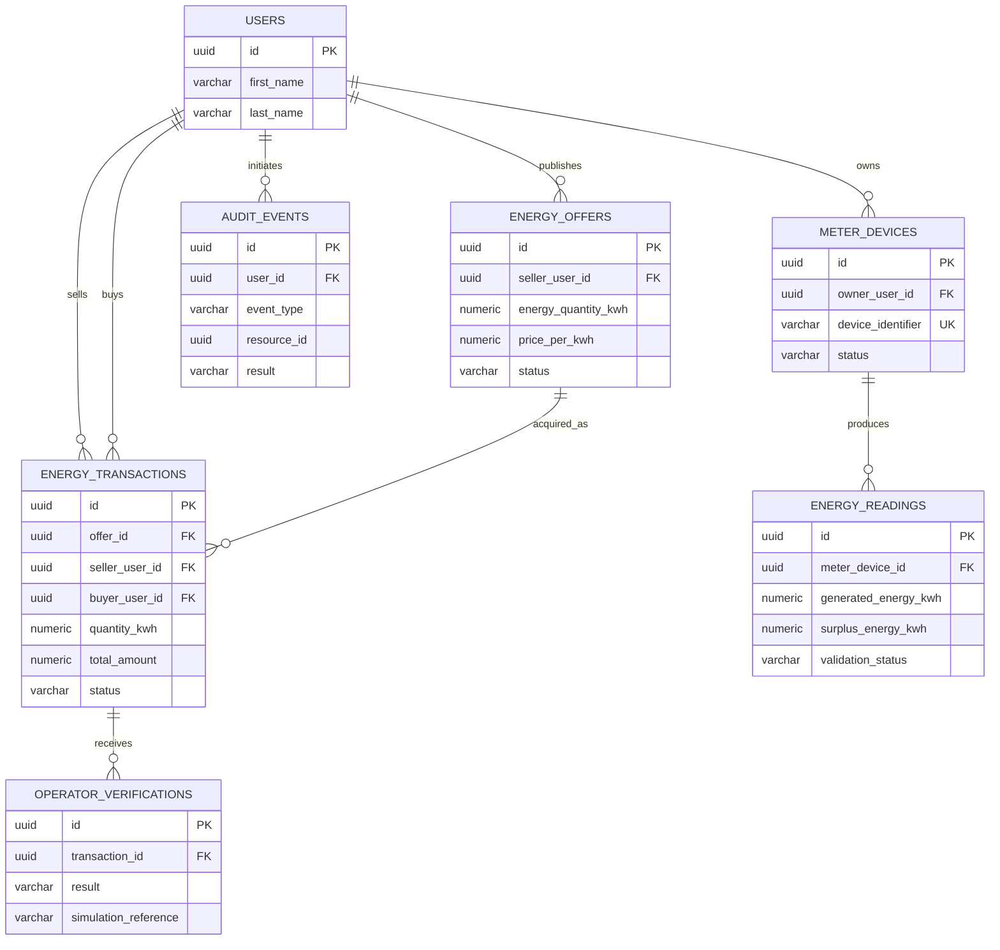

# EnergyProsumer-security: Domain Model

## Status and scope

This document includes both implemented and proposed design. F12, F14 and F16
implement offers, transactions, devices and readings; Auth also implements
roles, sessions, user administration and service-owned audit events. Other
proposals remain design-only. Facts marked **Existing** come from
the current repository; facts marked **Proposed** require implementation and review.

The business context is a simulated prosumer market. No physical energy dispatch,
payment, settlement, or real grid integration is performed.

## Bounded contexts and aggregate boundaries

| Context | Owner | Main responsibility |
|---|---|---|
| Identity and access | `auth-service` | `users`, `accounts`, `sessions`, password and JWT/refresh-token lifecycle |
| Energy market | `energy-market-service` | Offers, purchases, transactions, devices, readings, simulated verification |
| Audit and perimeter | Auth and Market own their durable events; Gateway handles perimeter telemetry | Security and business events, correlation, auditor queries |

`EnergyOffer` is the aggregate root for publication lifecycle. An offer may be
reserved and acquired only through an application use case that enforces its state
transition. `EnergyTransaction` is a separate aggregate because it has an
independent lifecycle and immutable economic snapshot. `MeterDevice` owns its
readings; `OperatorVerification` is a child record of a transaction. Audit events
are append-only records and are not part of a business aggregate.

Keeping offers, transactions, readings, and verification in one service is
recommended for the initial testbed. They participate in the same simulated
purchase and verification flow and require one database transaction. Separate
microservices would add distributed transaction, messaging, and consistency
complexity without an independent scaling or ownership need. They remain internal
modules (`offers`, `transactions`, `readings`, `verification`) so they can be
extracted later if the context grows.

## Existing identity model

The existing Auth migrations define:

- `users.id UUID` as the identity referenced by business records.
- `users.first_name`, `users.last_name`, `created_at`, and `updated_at`.
- `accounts.id UUID`, `accounts.user_id UUID`, normalized unique `username` and
  `email`, BCrypt `password_hash`, `status`, and audit timestamps.
- `sessions` linked to `accounts`, with only a refresh-token hash.

The Auth domain models `AccountStatus` (`ACTIVE`, `LOCKED`, `DISABLED`) and the
official roles `NORMAL_USER`, `ADMIN` and `SECURITY_AUDITOR`. The market service must
not duplicate `User` or `Account` and must accept the validated JWT `sub` UUID as
the user reference. It must not copy names, emails, passwords, JWTs, or refresh
tokens into market records.

## Proposed domain entities

### EnergyOffer

| Attribute | Type/meaning | Rule |
|---|---|---|
| `id` | UUID | Aggregate identifier |
| `sellerUserId` | UUID | FK/reference to `users.id`; seller cannot be buyer of own offer |
| `energyQuantityKwh` | `NUMERIC(12,3)` | Positive, bounded by configured maximum |
| `pricePerKwh` | `NUMERIC(14,2)` | Positive simulated unit price |
| `availableFrom`, `expiresAt` | `TIMESTAMPTZ` | `availableFrom < expiresAt` |
| `status` | enum | `ACTIVE`, `RESERVED`, `SOLD`, `CANCELLED`, `EXPIRED` |
| `publishedAt`, `updatedAt` | `TIMESTAMPTZ` | Server-generated timestamps |

**Recommendation:** store price per kWh, not a total price. The agreed total is
`quantity * pricePerKwh`, calculated with fixed decimal arithmetic and rounded
according to the future market money/measurement policy. This permits a partial
purchase only if that capability is explicitly approved. The initial scope should
acquire the full offer, which avoids inventory fragmentation. A transaction stores
both the quantity and price snapshot, so later offer edits cannot alter history.

Recommended lifecycle: `ACTIVE -> RESERVED -> SOLD`; `ACTIVE -> CANCELLED`;
`ACTIVE -> EXPIRED`; `RESERVED -> ACTIVE` on a failed or rejected acquisition;
`RESERVED -> SOLD` after a transaction is created. `SOLD`, `CANCELLED`, and
`EXPIRED` are terminal. An explicit expiry job or read-time expiry policy is still
to be selected.

### EnergyTransaction

| Attribute | Type/meaning | Rule |
|---|---|---|
| `id` | UUID | Transaction identifier |
| `offerId` | UUID | FK to `energy_offers.id` |
| `sellerUserId`, `buyerUserId` | UUID | FKs/references to `users.id` |
| `quantityKwh` | `NUMERIC(12,3)` | Immutable agreed quantity |
| `pricePerKwh` | `NUMERIC(12,4)` | Immutable agreed unit price |
| `totalAmount` | `NUMERIC(16,4)` | Immutable calculated snapshot |
| `createdAt`, `closedAt` | `TIMESTAMPTZ` | `closedAt` only after terminal result |
| `status` | enum | `PENDING_VERIFICATION`, `CONFIRMED`, `REJECTED`, `CANCELLED` |
| `idempotencyKey` | bounded text, optional | Unique per buyer and operation where used |

The transaction retains the seller, buyer, quantity, unit price, and total even
when the offer is later changed or deleted logically. The seller must equal the
offer owner, and the buyer must be the authenticated caller.

### MeterDevice and EnergyReading

`MeterDevice` contains `id UUID`, `ownerUserId UUID`, an opaque device identifier,
a credential hash (never the raw credential), `status`
(`ACTIVE`, `SUSPENDED`, `REVOKED`), and `registeredAt`. Device authentication is
separate from user JWT sessions; the device adapter validates its credential
and maps it to the device before accepting a reading. Revocation is terminal.

`EnergyReading` contains `id UUID`, `meterDeviceId UUID`, `generatedEnergyKwh`,
`surplusEnergyKwh`, `measuredAt`, `receivedAt`, and validation status
(`PENDING`, `VALID`, `INCONSISTENT`, `REJECTED`). Rules include non-negative
values and authenticated device association. Surplus exceeding generation is
retained as `INCONSISTENT`, never `VALID`. The device supplies a unique reading
UUID; different readings may share a timestamp. Future timestamps are rejected.
Validation is domain/application logic, not evidence of physical grid delivery.

### OperatorVerification

This simulated record contains `id UUID`, `transactionId UUID`, result
(`ACCEPTED` or `REJECTED`), `verifiedAt`, a non-sensitive reason, and a
`simulationReference`. The adapter is deterministic/configurable for tests and
does not call an electric utility. One transaction may have multiple attempts
only if retries are approved; otherwise enforce one current verification.

### AuditEvent

The durable design should contain `id UUID`, optional `userId`, event type,
occurred-at timestamp, source IP when available, resource type/id, result,
correlation ID, and non-sensitive metadata. Metadata must be allow-listed and
must never include passwords, JWTs, refresh tokens, device credentials, SQL,
request bodies, or secret values. Gateway currently publishes technical request
events without persistence; the durable ownership and event contract remain a
decision.

## Relationships

The `USERS` table is owned and written by Auth. The other tables are written by
the market service, except for the final audit ownership decision. A shared
PostgreSQL database makes these physical FKs enforceable but creates deployment,
migration, and schema coordination coupling; the services must still respect
write ownership.

## F14 implementation status

`EnergyTransaction` and `OperatorVerification` are implemented inside the
energy-market service with immutable economic snapshots, PostgreSQL locking,
persistent idempotency, and synchronous deterministic simulation.
